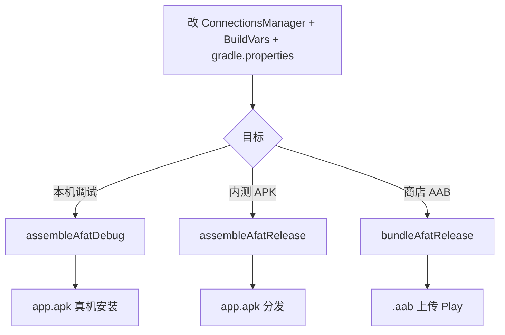

# 修改配置与打包

从改配置到产出 **APK / AAB** 的完整流程（Teamgram 自建服场景）。工程结构与服务端说明见 [Android客户端技术文档.md](Android客户端技术文档.md)。

---

## 一、要改哪些配置

Teamgram Android 需改两类配置：**连哪个服务端**、**应用身份与签名**。

### 1.1 服务端（必改）

| 文件 | 改什么 |
|------|--------|
| `TMessagesProj/jni/tgnet/ConnectionsManager.cpp` | `initDatacenters()` 中 `addAddressAndPort` 的 IP → 服务器地址 |
| （一般不改）同上 | MTProto 端口固定 **10443** |

```cpp
// initDatacenters() 内，约 1815 / 1854 行
datacenter->addAddressAndPort("192.168.1.13", 10443, 0, "");
```

改 C++ 后须 **重新编译**（会触发 NDK 构建）。详见 [服务端对接配置.md](服务端对接配置.md)。

### 1.2 应用身份（`BuildVars.java`）

文件：`TMessagesProj/src/main/java/org/telegram/messenger/BuildVars.java`

| 字段 | 说明 | 示例 |
|------|------|------|
| `APP_ID` | [my.telegram.org](https://my.telegram.org) 申请的 api_id | `1025907` |
| `APP_HASH` | 同上 api_hash | 32 位十六进制 |
| `SAFETYNET_KEY` | Google SafetyNet，不用可留空 `""` | |
| `GOOGLE_AUTH_CLIENT_ID` | Google 登录 OAuth Client ID | |
| `PLAYSTORE_APP_URL` | 自有应用商店页 | |
| `CHECK_UPDATES` | 是否检查官方更新，自建服建议 `false` | |

须与 iOS `build-system/*.json`、后端环境保持一致。

### 1.3 Gradle 全局配置（`gradle.properties`）

| 字段 | 说明 | 当前仓库示例 |
|------|------|----------------|
| `APP_PACKAGE` | 应用包名（applicationId） | `org.chatengine.messenger` |
| `APP_VERSION_CODE` | versionCode 整数，**每次发包递增** | `5837` |
| `APP_VERSION_NAME` | 显示版本号 | `11.9.0` |
| `RELEASE_STORE_PASSWORD` | 签名 keystore 密码 | |
| `RELEASE_KEY_ALIAS` | 密钥别名 | |
| `RELEASE_KEY_PASSWORD` | 密钥密码 | |
| `IS_PRIVATE` | 私有测试构建标记 | `false` |

### 1.4 签名与 Firebase（发布前替换）

仓库内含 **占位** 文件，上架前须换成自己的：

| 路径 | 用途 |
|------|------|
| `TMessagesProj/config/release.keystore` | Release / Debug 签名（当前 debug 也用它） |
| `TMessagesProj/google-services.json` | Firebase 推送（`TMessagesProj_App` 模块引用） |

Firebase：在 [Firebase Console](https://console.firebase.google.com/) 创建 Android 应用，包名与 `APP_PACKAGE`（及 debug 的 `.beta` 后缀变体）一致，下载 `google-services.json` 放到 `TMessagesProj/`。

---

## 二、三种打包路径



当前 `settings.gradle` 默认只启用 **`TMessagesProj_App`**（常规版）。华为 / HockeyApp / Standalone 变体默认注释，需自行取消 `include` 后再编对应模块。

---

## 三、路径 A：开发调试包

适合：本机连真机或模拟器，快速验证服务端。

### 3.1 修改配置

1. `ConnectionsManager.cpp` → 服务器 IP  
2. `BuildVars.java` → `APP_ID` / `APP_HASH`  
3. （可选）`gradle.properties` → `APP_PACKAGE`

### 3.2 命令行编译

```bash
cd teamgram-android

# 首次或改 native 代码后
./gradlew :TMessagesProj_App:assembleAfatDebug
```

### 3.3 产物与包名

| 项 | 值 |
|----|-----|
| APK 路径 | `TMessagesProj_App/build/outputs/apk/afat/debug/app.apk` |
| 包名 | `{APP_PACKAGE}.beta`（debug 自动加 `.beta` 后缀） |
| ABI | 仅 `arm64-v8a`（`afat` flavor） |

### 3.4 Android Studio

1. **Open**（不要 Import）打开 `teamgram-android` 根目录  
2. 选模块 `TMessagesProj_App`，Build Variant：**afatDebug**  
3. 连接真机 → Run  

环境要求（见根目录 `build.gradle` / 各模块 `build.gradle`）：

| 项 | 版本 |
|----|------|
| Android Gradle Plugin | 8.4.2 |
| compileSdk | 34 |
| NDK | 21.4.7075529 |
| JDK | 17（推荐，与 AGP 8 匹配） |

---

## 四、路径 B：Release APK（内测分发）

适合：企业内测、侧载安装，不走上架商店。

### 4.1 准备签名

```bash
# 使用自有 keystore（示例）
keytool -genkey -v -keystore TMessagesProj/config/release.keystore \
  -alias mykey -keyalg RSA -keysize 2048 -validity 10000
```

在 `gradle.properties` 填写对应密码与别名。

### 4.2 编译

```bash
cd teamgram-android

./gradlew :TMessagesProj_App:assembleAfatRelease
```

### 4.3 产物

| 项 | 值 |
|----|-----|
| APK 路径 | `TMessagesProj_App/build/outputs/apk/afat/release/app.apk` |
| 包名 | `APP_PACKAGE`（无 `.beta` 后缀） |
| 混淆 | `minifyEnabled true`，ProGuard 规则见 `TMessagesProj/proguard-rules.pro` |

安装：

```bash
adb install -r TMessagesProj_App/build/outputs/apk/afat/release/app.apk
```

---

## 五、路径 C：AAB（Google Play）

适合：上架 Play 商店。

### 5.1 多 ABI 包（可选）

`afat` 仅 arm64。若需 armeabi-v7a / x86 等，使用 `bundleAfat` flavor：

```bash
./gradlew :TMessagesProj_App:bundleBundleAfatRelease
```

产物：`TMessagesProj_App/build/outputs/bundle/bundleAfatRelease/*.aab`

### 5.2 版本号规则

`build.gradle` 中：

```groovy
output.versionCodeOverride = defaultConfig.versionCode * 10 + variant.productFlavors.get(0).abiVersionCode
```

发包前递增 `gradle.properties` 的 `APP_VERSION_CODE`。

### 5.3 Play 上架注意

- 包名 `APP_PACKAGE` 须在 Play Console 预先注册  
- 替换占位 `google-services.json`、自有 `release.keystore`  
- **不要**使用官方 Telegram 名称与 logo（GPL 与商标要求）  
- Play 结算相关：`BuildVars.IS_BILLING_UNAVAILABLE` 可按需关闭 Google Billing  

---

## 六、打包前检查清单

| # | 检查项 |
|---|--------|
| 1 | `ConnectionsManager.cpp` IP 为可达地址（局域网调试注意手机与服务器同网段） |
| 2 | 后端已启动，`10443` / `11443` 防火墙放行 |
| 3 | `APP_ID` / `APP_HASH` 有效且各端一致 |
| 4 | `APP_PACKAGE` 与签名证书、Firebase 应用 ID 一致 |
| 5 | `APP_VERSION_CODE` 大于上一版本 |
| 6 | 已替换占位 keystore 与 `google-services.json`（发布场景） |
| 7 | 应用名与图标未冒用官方 Telegram |

---

## 七、常见问题

| 现象 | 处理 |
|------|------|
| 编译 NDK 失败 | 确认 Android Studio 已安装 NDK 21.4.7075529；`sdkmanager` 安装 CMake 3.10.2 |
| Gradle OOM | `gradle.properties` 已设 `-Xmx4096M`，可再加大 |
| 安装后无法连接 | 查 IP/端口；私有 IP 在蜂窝网络下不可达 |
| 登录握手失败 | RSA 密钥与后端一致，见 `teamgram.io/enterprise/docs/更换授权密钥.md` |
| 测试验证码 | 企业版测试环境常见 **12345** |
| Debug 包名对不上 Firebase | Debug 使用 `{APP_PACKAGE}.beta`，须在 Firebase 单独建应用 |
| 只要 arm64 减小体积 | 保持 `afat` flavor，勿用 `bundleAfat` |

---

## 八、相关命令速查

```bash
cd teamgram-android

# 1. 改配置
vim TMessagesProj/jni/tgnet/ConnectionsManager.cpp
vim TMessagesProj/src/main/java/org/telegram/messenger/BuildVars.java
vim gradle.properties

# 2. 调试 APK
./gradlew :TMessagesProj_App:assembleAfatDebug

# 3. 发布 APK
./gradlew :TMessagesProj_App:assembleAfatRelease

# 4. Play AAB（多 ABI）
./gradlew :TMessagesProj_App:bundleBundleAfatRelease

# 5. 清理重建
./gradlew clean :TMessagesProj_App:assembleAfatDebug
```

---

相关：[服务端对接配置.md](服务端对接配置.md)、[Android客户端技术文档.md](Android客户端技术文档.md)、`teamgram/docs/企业版安装指南.md`、`teamgram-ios/docs/修改配置与打包.md`。
